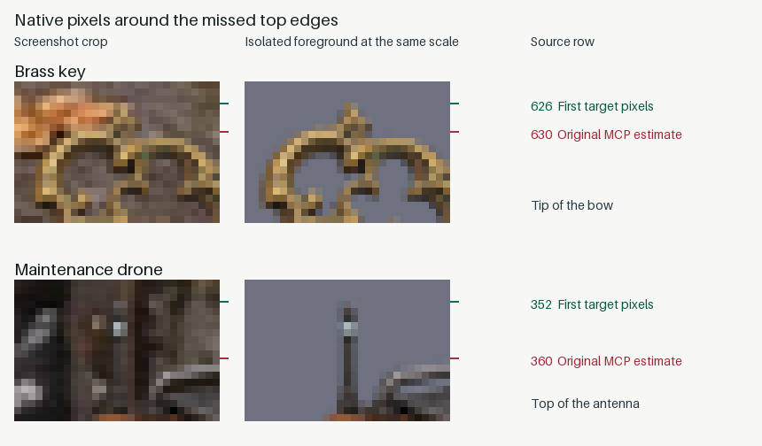

# Native screenshot height accuracy

2026-11-19 · Historical follow-up to the [single-target study](single-target.md). The 72 scored predictions and the 21 development records are separate datasets.

Across two blind repeats on all nine screenshots, the updated MCP reduced mean absolute height error from **1.50 to 0.89 source pixels**. The key is 63 pixels tall. Estimates changed from 58/58 to 64/58. The drone is 75 pixels tall. Estimates changed from 66/67 to 75/67. Both heights came within one pixel in the first repeat and both remained short in the second.

The new crop detail view improved average height and slightly reduced average edge error. Exact boxes fell from **14/18 to 10/18**, and mean absolute width error rose from 0.11 to 0.50 pixels. Every previously exact box that lost exactness was still within one pixel on every edge. The existing natural crop and rulers remain available. “Updated MCP” here refers to the repeated-boundary variant in this experiment.

## Reproducing the misses

I replayed the recorded crop calls and compared the returned natural PNGs with the foreground alpha and the full-image RGB difference. The key crop covered rows 620–691 and the drone crop covered rows 349–433. Both included the complete target. Both reached the host at eight display pixels per source pixel. In each original session Codex requested the same crop twice.

The key’s true vertical interval is [626, 689). Its bow begins with two visible pixels against a leaf at x=785–786. The original prediction [630, 688) lost four rows at the bow and one at the teeth. The drone’s interval is [352, 427). An antenna at x=1070–1072 accounts for the first eight rows. The original prediction [360, 427) began where the silhouette widens. The known layers were used only for this diagnosis and scoring. The server and cold sessions received the composite alone.

Two additional cold sessions were asked to explain their edge choices. The key session classified the point (785, 626) as part of the orange leaf. The drone session classified (1071, 352) as part of a shelving upright and chose the raised handle at row 360. The isolated foregrounds show that both rejected points belong to the targets. These responses document the models’ stated interpretations in the diagnostic sessions. They are excluded from the scored comparison. [Diagnostic responses and pilot runs](native-height-development.jsonl)

## What changed

Requesting `show_detail` with a proposed box and padding returns the natural crop and a second view with the proposal and possible tips marked. A tip qualifies when a run of fine color detail in the padding continues across the proposal, either as texture or as a narrow stroke contrasting with both sides. For a side with a single qualifying tip, `traced_edges_px` reports the half-open source coordinate. The model must still decide whether that structure belongs to its target. In the drone pilot the feature at (1071, 352) contrasted with both flanks for ten consecutive source rows. Replaying the original underestimated boxes with 16 pixels of padding recovered both vertical key edges and the drone's top edge. That drone replay also flagged an unrelated background feature below the claw.

A color stretch alone left height errors of −4 and −8 pixels on the key and drone. Highlighting color edges and the proposed rectangle yielded −3 and −8. Adding candidate points yielded 0 and −8 in the two-scene pilot. An interim comparison of that version was stopped during the first pass when the trace-continuity check was introduced. These development runs are recorded separately. [Development predictions](native-height-development.jsonl)

## Blind comparison

Two fresh sessions per scene and condition, nine original native-resolution PNGs, 72 predictions. The prompts, model (gpt-6.2-astra), medium reasoning effort, image hashes, placements and two-pixel scoring rules match the original run. Screenshot alone, previous MCP and continuity-check MCP were rerun in rotating order by scene. The second repeat reversed the initial arm order. The repeated-boundary variant was then tested twice on all nine with the same controls. It perturbs the proposed box by three pixels in either direction and reports tips that recur across measurements, with their normalized edge coordinates. Height, width and edge error below are mean absolute errors in original pixels. Exact requires all four edges to match.

Replaying the updated MCP calls from both scored repeats recovered the true top row for both targets every time. The first drone call returned only the antenna tip. The second also flagged a background point below the gripper at (1069, 440). On the key, the two calls placed the lower edge one and two pixels beyond the true edge. A repeated local image feature can still belong to the scenery. These measurements explain what information Codex received. The explanatory sessions above establish what two separately prompted models said they saw.

| Condition | Height error (px) | Width error (px) | Edge error (px) | Edges within 2 px | Position and size within 2 px | Exact box |
|---|---|---|---|---|---|---|
| Screenshot alone | 2.00 | 1.06 | 0.76 | 14/18 | 13/18 | 4/18 |
| Previous MCP | 1.50 | 0.11 | 0.40 | 14/18 | 14/18 | 14/18 |
| Continuity check | 1.17 | 0.28 | 0.36 | 15/18 | 15/18 | 10/18 |
| Repeated boundary check | 0.89 | 0.50 | 0.35 | 15/18 | 15/18 | 10/18 |

### Heights by scene

The two entries are the predicted heights in repeats 1 and 2, respectively. All values are in source pixels.

| Target | True height | Screenshot alone | Previous MCP | Continuity check | Repeated boundary check |
|---|---|---|---|---|---|
| Railway ticket | 36 | 37 / 38 | 36 / 36 | 36 / 36 | 36 / 36 |
| Brass key | 63 | 58 / 59 | 58 / 58 | 59 / 63 | 64 / 58 |
| Eyedropper cursor | 42 | 42 / 42 | 42 / 42 | 43 / 42 | 42 / 42 |
| Open compass | 87 | 87 / 88 | 87 / 87 | 87 / 87 | 87 / 87 |
| Maintenance drone | 75 | 67 / 68 | 66 / 67 | 67 / 67 | 75 / 67 |
| Map label | 22 | 23 / 23 | 22 / 22 | 22 / 22 | 22 / 22 |
| Menu stamp | 58 | 58 / 58 | 58 / 58 | 58 / 58 | 58 / 58 |
| Luna moth | 48 | 50 / 51 | 48 / 48 | 48 / 48 | 48 / 48 |
| Marshal flag | 45 | 46 / 45 | 45 / 45 | 45 / 45 | 46 / 46 |

### Other seven scenes

The key and drone informed the fix. These seven did not. The same scorer was used for every scene.

| Condition | Height error (px) | Width error (px) | Edge error (px) | Edges within 2 px | Position and size within 2 px | Exact box |
|---|---|---|---|---|---|---|
| Screenshot alone | 0.86 | 0.57 | 0.36 | 14/14 | 13/14 | 4/14 |
| Previous MCP | 0.00 | 0.00 | 0.00 | 14/14 | 14/14 | 14/14 |
| Continuity check | 0.07 | 0.21 | 0.07 | 14/14 | 14/14 | 10/14 |
| Repeated boundary check | 0.14 | 0.14 | 0.07 | 14/14 | 14/14 | 10/14 |

Each condition has two measurements per screenshot. This measures repeatability on nine fixed images. The JSONL uses `unaided`, `reference`, `aided`, and `repeatable` for the four conditions in table order. It preserves the predictions and tool arguments. For each of the 18 calls to the final variant, `replayed_tip_pixels` records the source pixel locations reproduced with both the frozen test algorithm and the implementation used for that run. [All predictions and MCP calls](native-height.jsonl) · [Original results](single-target.md)

The current repository retains a deterministic regression for the two original missed tips. Use it to check a code change independently of model variability. [Compositor and edge regressions](../../tests/test_composite_geometry.py)
